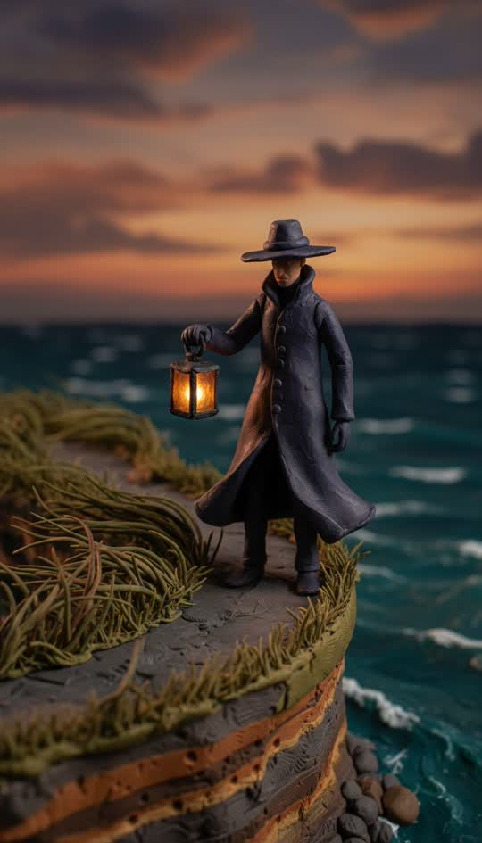

# Claymation

Stop-motion plasticine on a real miniature set.



```
Stop-motion claymation shot on a real miniature set: every object modelled in soft plasticine with visible thumbprints, fingernail dents and tool marks in the clay, slightly uneven hand-rolled surfaces, matte clay sheen under warm practical studio lights, shallow macro depth of field, tiny set-build scale. Not painted, not CGI, no smooth digital surfaces, no gradients
```

**Best for** character comedy, product explainers, anything that benefits from
looking handmade rather than generated.

**Notes**
- **The thumbprints are the style.** Remove that clause and it renders as a
  smooth 3D cartoon.
- Macro depth of field sells the miniature scale — keep it in the string.
- Clay faces carry broad expressions well and subtle ones badly. Write big
  emotions.
