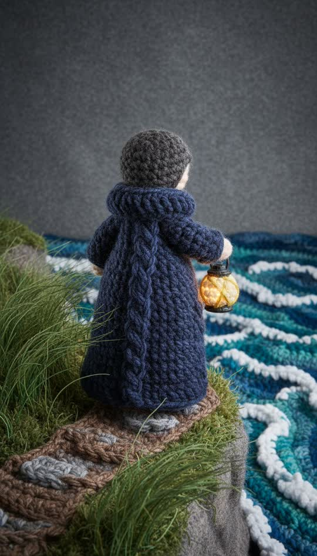

# Crochet and yarn

Everything crocheted from thick wool, amigurumi style.



```
Everything crocheted from thick wool yarn: visible individual stitches and crochet loops across every surface, fuzzy fibre halo catching the light, soft stuffed amigurumi shapes with seams where pieces are sewn together, slightly lumpy handmade proportions, photographed on a felt surface under soft light. Not painted, not CGI, no smooth surfaces, no gradients
```

**Best for** cosy content, children's stories, craft and hobby niches, gift
and seasonal ads.

**Notes**
- "Individual stitches" plus "fibre halo" is what makes it read as real yarn
  rather than a fuzzy filter.
- The lumpy-proportions clause is load-bearing: perfect proportions look CGI.
- Detail is coarse by nature, so avoid shots that depend on small props.
