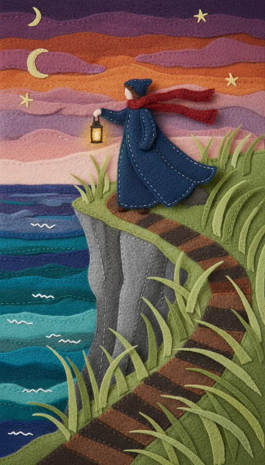

# Felt diorama

Cut felt, stitched and layered.



```
Handmade felt diorama: every element cut from thick coloured craft felt with slightly fuzzy edges, visible stitching along seams, layered flat shapes with small shadows between layers, soft matte fibre texture throughout, limited palette of eight felt colours, photographed under soft even light. Not painted, no gradients, no digital shading
```

**Best for** bedtime stories, gentle explainers, seasonal and craft content.

**Notes**
- Closest cousin to `papercraft`; felt reads warmer and softer, paper reads
  sharper and more graphic.
- "Visible stitching" is the single detail that proves the medium.
- The counted palette matters here as much as in papercraft.
