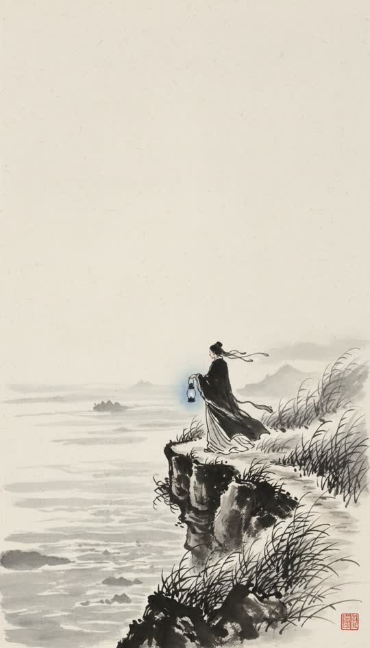

# Ink wash



Sumi-e on rice paper. Mostly empty frame, a few confident strokes.

```
Traditional Chinese ink wash painting on rice paper, black sumi ink in washes and dry-brush strokes, vast negative space, mist between planes, a single muted indigo accent, visible paper fibre
```

**Best for** myth, legend, solitude, historical pieces, anything contemplative.

**Notes**
- The negative space is the style. Do not fill the frame — write shot briefs
  with one subject and nothing else.
- Subjects read small in frame by default, which suits wides and establishing
  shots and fights close-ups. Plan the shot list accordingly.
- Faces are suggested rather than drawn, so this pack is weak for a story that
  depends on expression.
