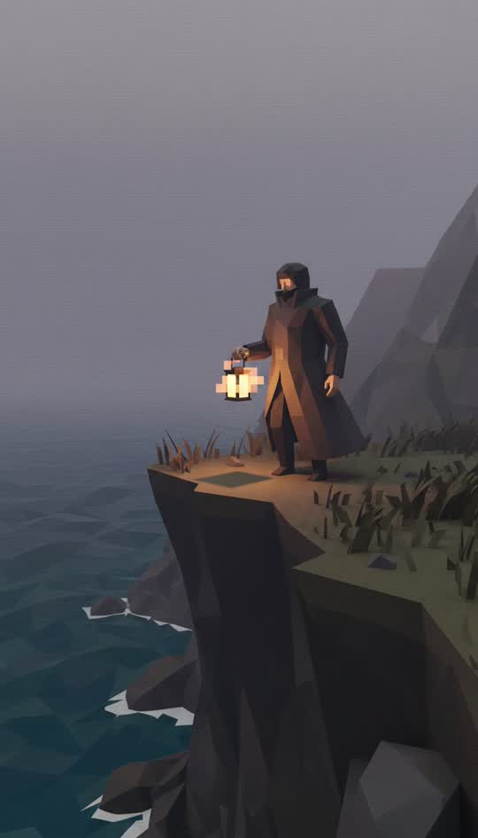

# Low poly



PS1-era real-time 3D. Visible triangles, fog, and no apology for either.

```
Retro PlayStation-1 era real-time 3D render: the whole scene built from a small number of large flat-shaded triangles with visible hard polygon edges and faceted silhouettes, no smooth normals, low-resolution pixelated textures with obvious texture warping, vertex jitter, thick distance fog hiding the far plane, 256-colour palette, 4:3-era game engine look. Not an illustration, no smooth gradients, no painted shading, no anti-aliasing
```

**Best for** retro, gaming, internet culture, anything knowingly nostalgic.

**Notes**
- Like papercraft, the negative clause is required. Without it you get flat
  gradient illustration, not polygons.
- "Thick distance fog" does double duty: it is period-accurate and it hides the
  far plane, which is where this style otherwise falls apart.
- Faces are a few triangles, so do not write a story that needs expression.
