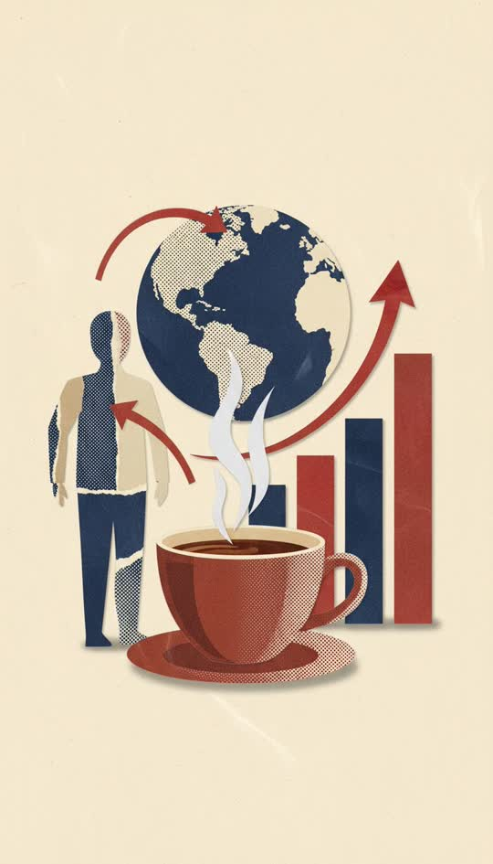

# Paper collage



Cut magazine and halftone print. The editorial explainer look.

```
Vox-style paper collage: every element a separate cut-paper shape with visible torn and scissor-cut edges, layered with hard drop shadows on a flat background, halftone newsprint and photocopied magazine textures, limited editorial palette of cream, red and navy, deliberate hand-assembled scrapbook look
```

**Best for** editorial explainers, data and trends, economics, politics,
anything with a chart in it.

**Notes**
- **Needs an editorial subject.** A figure, a chart, a globe, arrows between
  things. The same string on a cinematic landscape drifts to illustration.
- This pack renders legible, correctly spelled on-screen text — rare, and
  useful here. Unlike the story packs, let it have labels.
- The counted palette is load-bearing. Name three colours, not "muted tones".
