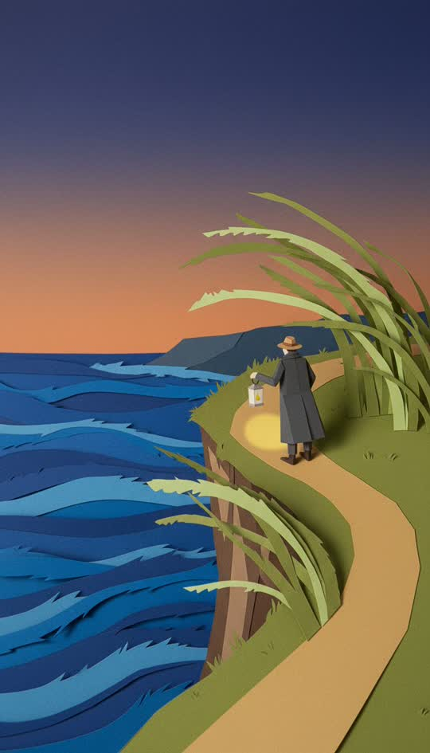

# Papercraft



Real construction paper, cut and layered, photographed.

```
Papercraft stop-motion set built from real construction paper: every element a separate flat paper shape cut with scissors, visible fibrous torn edges, slight curl where pieces lift off the surface, each layer casting a small hard shadow onto the one behind, matte uncoated paper grain throughout, limited palette of six flat paper colours, photographed straight on under soft studio light. Not painted, no gradients, no brush strokes, no blending, no digital shading
```

**Best for** whimsy, children's stories, gentle fables.

**Notes**
- The long negative clause at the end is required, not optional. Without it
  this style renders as painted illustration that merely *suggests* paper.
- "Six flat paper colours" beats any adjective about palette.
- Layer shadows are what sell it. Keep "casting a small hard shadow".
