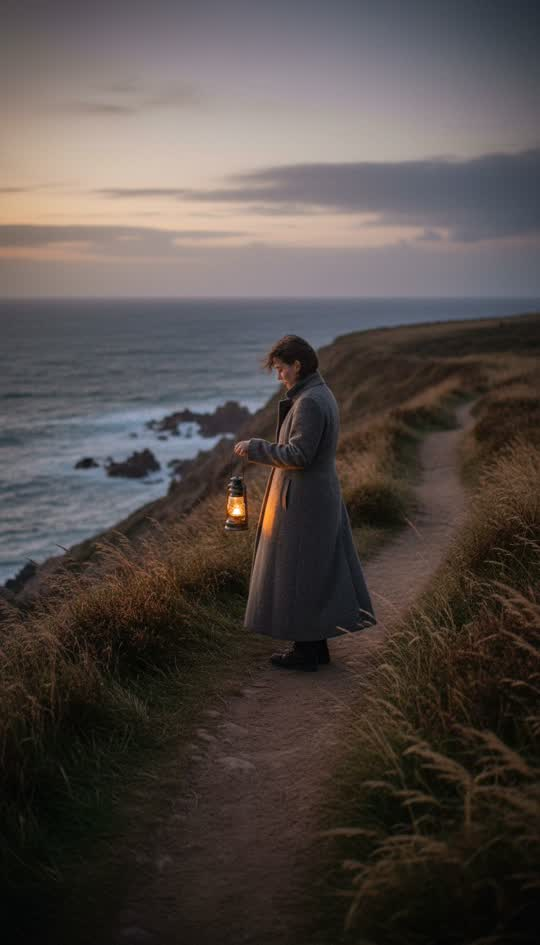

# Ultra realistic

Photographed, not illustrated.



```
Photorealistic cinematography shot on a full-frame camera with an 85mm lens at f/1.8: true-to-life skin texture and fabric weave, natural dusk light with accurate falloff, subtle lens vignetting and chromatic aberration, fine film grain, shallow depth of field with creamy bokeh. Not an illustration, not a painting, no stylisation
```

**Best for** testimonial-adjacent pieces, travel, documentary, premium product.

**Notes**
- Naming a **lens and aperture** does more than any adjective about realism.
- This is the hardest pack for character consistency — real faces drift more
  than stylised ones. Use a reference sheet and expect more QC repaints.
- Check output against the likeness rules before publishing: a photoreal person
  who resembles someone real is a different problem from a stylised one.
