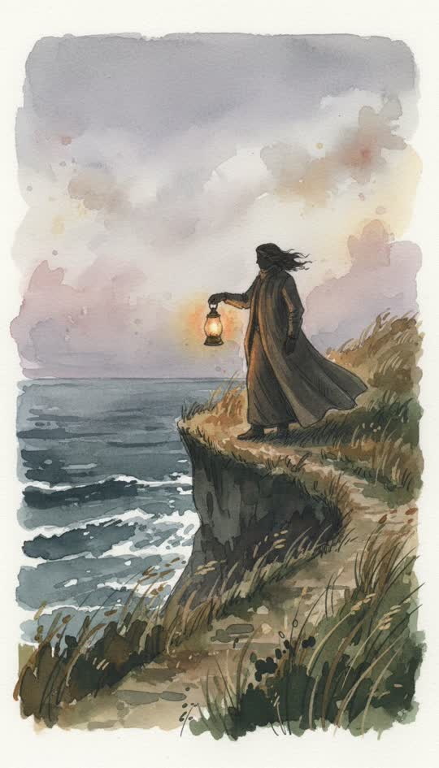

# Watercolour



Loose pigment on cold-press paper, pencil showing through.

```
Loose watercolour illustration on cold-press paper, visible pigment blooms and granulation, soft wet edges bleeding between shapes, pencil under-drawing showing through, muted earth palette with one warm accent
```

**Best for** memory, nostalgia, gentle explainers, nature, slower stories.

**Notes**
- The blooms and the visible pencil are what stop it looking like a digital
  painting. Keep both words in the string.
- Edges stay soft, so it handles weather and water well and hard-edged
  machinery badly.
